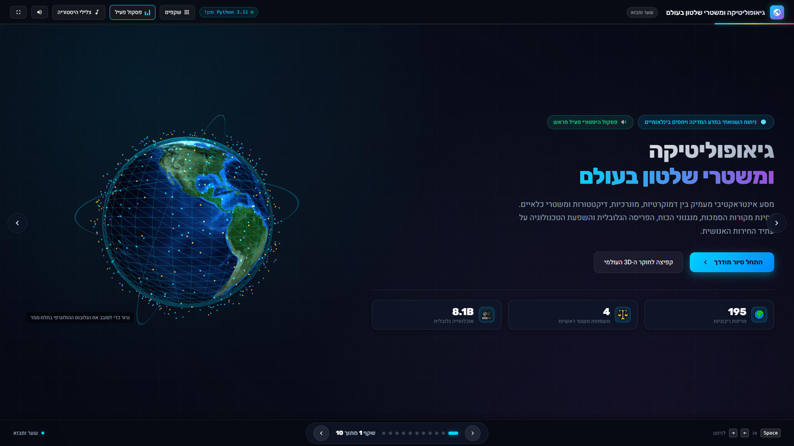
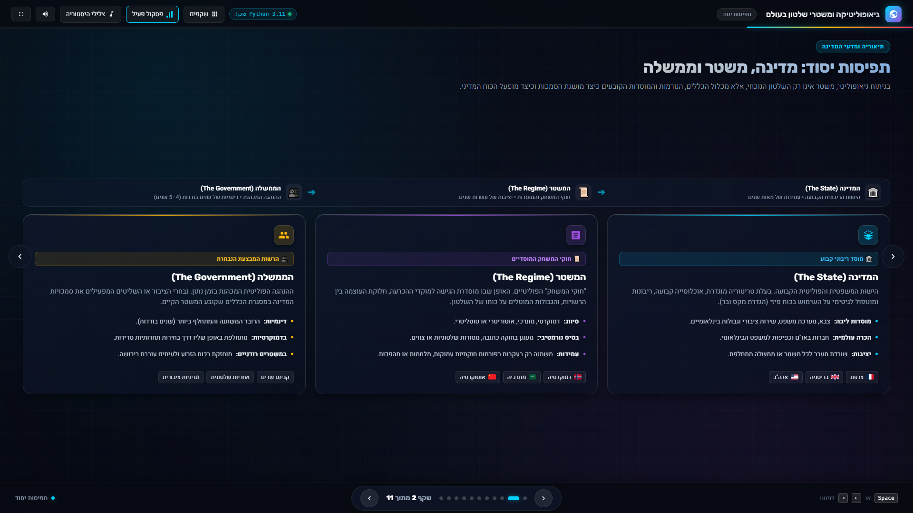
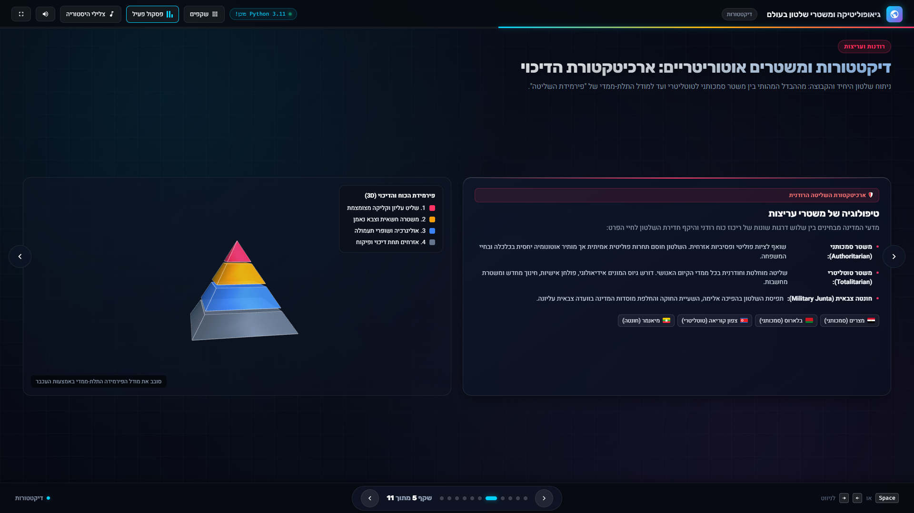
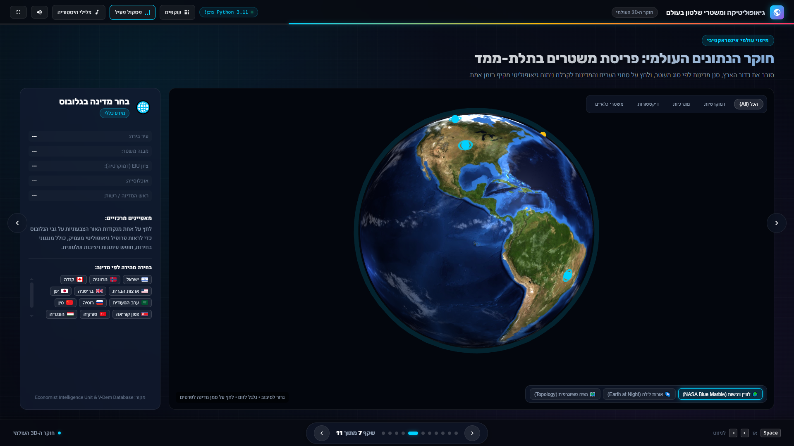
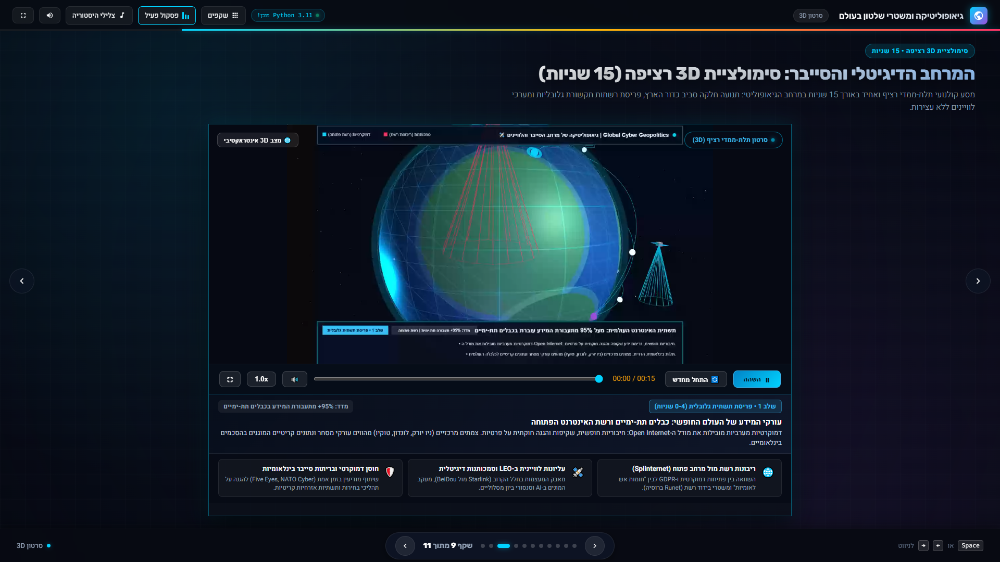
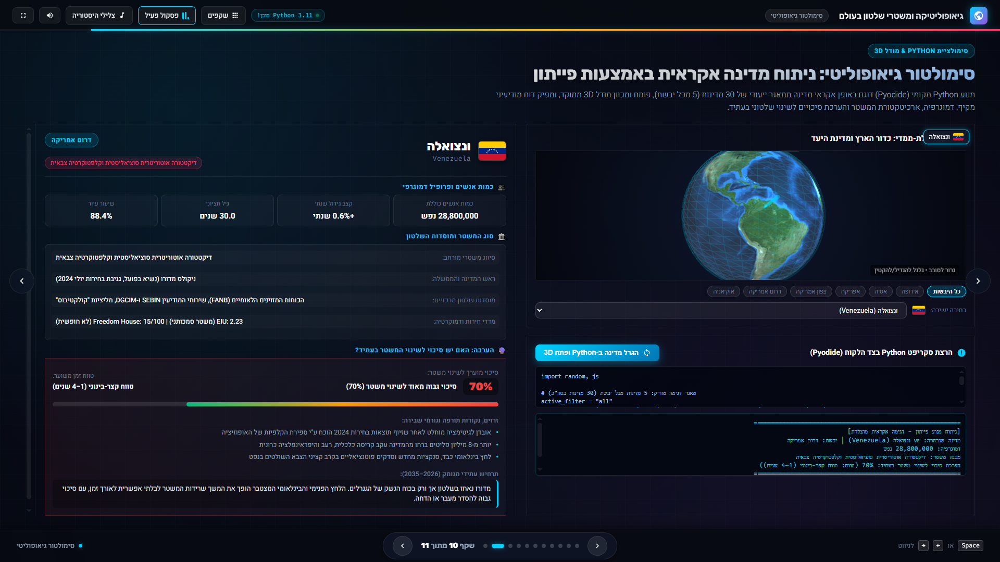
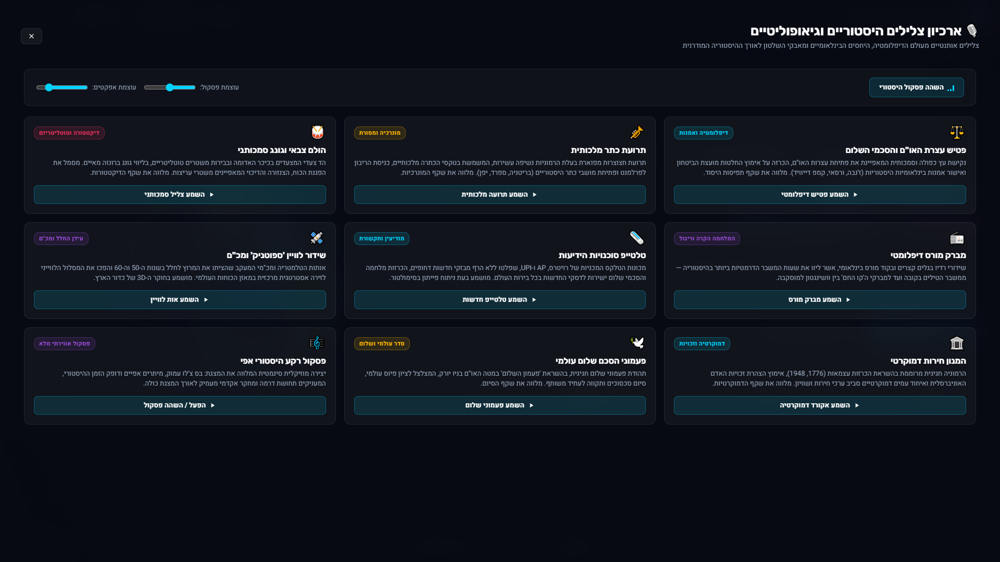

# גיאופוליטיקה ומשטרי שלטון בעולם – מצגת אינטראקטיבית בתלת-ממד
## Geopolitics & Global Regimes: Interactive 3D Presentation & Python Engine

מצגת אינטראקטיבית חדשנית ועשירה בקובץ HTML עצמאי יחיד (`index.html`), הכוללת סצנות תלת-ממדיות אינטראקטיביות באמצעות Three.js, מנוע הרצת קוד פייתון מקומי בדפדפן (Pyodide WebAssembly), תמיכה מלאה ומדויקת בשפה העברית ובתקני RTL ו-BiDi, עיצוב מודרני מרהיב מותאם למסך מלא (Fullscreen) וניווט רב-ערוצי.

---

## 📸 גלריית המחשות ויזואליות וצילומי מסך מהמערכת (Visual Showcase & Engineering Depth)

> [!IMPORTANT]
> **הערת הגשה אקדמית למרצה ולבודקי הפרויקט:**  
> להלן צילומי מסך חיים ברזולוציה גבוהה מתוך המערכת הפעילה, המציגים בבירור את עומק הפיתוח ההנדסי והתוכני: סצנות התלת-ממד ב-Three.js, סרטון הסימולציה הקולנועי הרציף (15 שניות), מנוע ה-Python הרץ מקומית ב-WebAssembly עם פלט המסוף (stdout), מודל כדור הארץ הממוקד עם גבולות וצבעי מדינות, ומערכת הסאונד האוטונומית.

### 1. שער המצגת: גלובוס 3D הולוגרפי, נתוני פתיחה וסרגל סטטוס מערכת


* **אלמנט תלת-ממדי חי (Three.js):** גלובוס כדור הארץ הולוגרפי מסתובב בזמן אמת, מוקף במערכת עננים מרחפת, טבעות מסלול גיאופוליטיות והילת חלקיקים קוסמית זוהרת (Particle System). ניתן לגרירה ולסיבוב אינטראקטיבי מלא בעכבר ובמגע.
* **כרטיסי מידע יוקרתיים (Glassmorphism):** תצוגת נתוני פתיחה מרכזיים מזכוכית כהה (195 מדינות מוכרות, 4 משפחות משטר ראשיות, 8.1 מיליארד נפש).
* **אינדיקטורי מערכת חיים:** חיווי סטטוס טעינה של מנוע הפייתון (Pyodide WebAssembly Ready) בסרגל העליון, בקר מסך מלא, ובקר פסקול אפי הפעיל אוטומטית עם אנימציית אקולייזר מונפשת.

---

### 2. תפיסות יסוד במדע המדינה: ציר זרימה כרונולוגי ודגלי מדינות


* **ארכיטקטורה מושגית מעמיקה:** ציר זרימה כרונולוגי המבחין באופן חד בין **מדינה** (קביעות של מאות שנים), **משטר** (יציבות של עשרות שנים), ו**ממשלה** (דינמיקה של שנים ספורות).
* **תיאוריה פוליטית קלאסית:** ניתוח הגדרת המונופול הלגיטימי על הפעלת כוח פיזי (מקס ובר) וציר המתח המתמיד שבין חירות הפרט לסדר הציבורי.
* **דגלים גרפיים חדים (FlagCDN):** הטמעת דגלים לאומיים ברזולוציה גבוהה לצד תגיות ארכיטקטורה חוקתית ואימוג'י נושאיים.

---

### 3. דיקטטורות ומשטרים אוטוריטריים: פירמידת השליטה והדיכוי התלת-ממדית


* **מודל תלת-ממדי אינטראקטיבי (Three.js 3D Pyramid):** הדמיה תלת-ממדית חיה של פירמידת השליטה ב-4 שכבות צבעוניות הניתנת לסיבוב מלא בכל הצירים, ממורכזת אנכית ללא חיתוך ועם מרווחים מאוזנים.
* **מטריצת טיפולוגיות משולשת:** השוואה אקדמית יסודית בין סמכותנות (Authoritarianism – ציות פסיבי), טוטליטריזם (Totalitarianism – שינוי תודעתי כולל), וחונטות צבאיות (Military Juntas – כפייה ביטחונית).
* **אפקטי סאונד מותאמים:** כניסה לשקף מפעילה צליל הולם תופי מצעד צבאי וגונג סמכותני המסונתזים בזמן אמת ב-Web Audio API.

---

### 4. חוקר הגלובוס העולמי: הדמיית NASA 3D, בורר שכבות וכרטיסיות מידע


* **גלובוס תלת-ממדי מלא (Three.js & OrbitControls):** חקירה חופשית של כדור הארץ ב-360 מעלות עם זום, הטיה וסיבוב חלקים.
* **טקסטורות לוויין ריאליסטיות:** תמיכה בטקסטורת יום NASA Blue Marble, אורות לילה (Earth at Night) ומפה טופוגרפית באמצעות בורר שכבות אינטראקטיבי, לצד שכבת עננים מרחפת עצמאית.
* **סינון גיאופוליטי ואינטראקציית Raycaster:** סמני מדינות מוגבהים לפי 4 צבעי משטר, כרטיסיית מידע גיאופוליטי מורחבת בלחיצה על מדינה, רצועת לחצני בחירה מהירה (Quick Chips), וצליל טלמטריית לוויין וסונאר מכ"ם.

---

### 5. המרחב הדיגיטלי והסייבר: סרטון תלת-ממדי קולנועי אינפורמטיבי רציף (15 שניות)


* **העשרת הסרטון במידע גיאופוליטי מעמיק (Informative 3D Video):**
  - **תוויות תלת-ממדיות מרחביות (3D Spatial City Labels):** סמני ערים בינלאומיות וצמתים אסטרטגיים הנעים בפרספקטיבה עם סיבוב כדור הארץ, בליווי סיווג משטר ותפקיד קיברנטי (ניו יורק – דמוקרטיה ורשת פתוחה, לונדון – פרלמנטריזם ורגולציה, בייג'ינג – סמכותנות וחומת האש הגדולה, מוסקבה – משטר ריכוזי וריבונות Runet, ירושלים – דמוקרטיה ומגן סייבר, טוקיו – ציר טכנולוגי פסיפי).
  - **כתוביות תעודה אינפורמטיביות מובנות (Documentary Lower-Third):** שכבת מידע פנורמית בתחתית הסרטון המסבירה באופן שוטף ומדויק את 4 השלבים הכרונולוגיים של המאבק הגיאופוליטי (כבלי תקשורת תת-ימיים, סמכותנות ומעקב לווייני LEO, לוחמת סייבר ופיצול רשתות Splinternet, ובריתות מגן דמוקרטיות).
  - **סרגל כותרת עליון ומקרא משטרים (Geopolitical Legend):** אבחנה גרפית ברורה בין דמוקרטיות (רשת פתוחה וחופש מידע) לבין משטרים סמכותניים (ריבונות רשת ומעקב המונים).
* **תדריך מודיעיני חי ומסונכרן (Live Geopolitical Briefing):** פאנל ייעודי תחת הנגן המתעדכן בזמן אמת לפי שניות הניגון ומציג תובנות אקדמיות ומדדים כמותיים מובהקים (95%+ תעבורה תת-ימית, 70+ מדינות במעקב המונים, 3.4B נפש תחת צנזורה, 84% שיתוף פעולה בסייבר).
* **שלושה עמודי תווך גיאופוליטיים אינטראקטיביים:** כרטיסי מידע אינטראקטיביים בלחיצה (Splinternet, LEO Space Dominance, Democratic Resilience) המאפשרים גם קפיצה ישירה לקטע הרלוונטי בסרטון.
* **טיסה קולנועית רציפה וחלקה:** שמירה על רציפות תנועה מושלמת ללא עצירות וללא מדדי FPS טכניים מיותרים.

---

### 6. סימולטור גיאופוליטי חי: הרצת Python מקומית ב-WebAssembly, פלט מסוף וגלובוס ממוקד


* **מנוע Python אמיתי בצד הלקוח (Pyodide 0.26.4 WebAssembly):** ביצוע חישובים ואלגוריתמיקה מורכבת של קוד Python מקורי הרץ כולו בזיכרון הדפדפן ללא שרת חיצוני.
* **מסוף פלט חי (Interactive Terminal Stdout):** הדפסה ישירה של פלט הריצה המודיעיני למסוף הטקסט – דגימה אקראית מתוך מאגר מובנה של 30 מדינות (5 מכל יבשת), חישוב התפלגויות, מדד EIU, והערכת הסתברות עתידית.
* **גלובוס תלת-ממדי ממוקד עם גבולות בינלאומיים (Three.js):** אנימציית טיסה חלקה (Fly-to) לקואורדינטות המדינה הנבחרת, שרטוט גבולות גיאוגרפיים מדויקים (`THREE.LineLoop`), שטח פנים כדורי מלא בצבעי המשטר/הלאום (`THREE.Mesh`), אלומת לייזר הולוגרפית וטבעת מכ"ם פועמת.
* **תיק מודיעיני מקיף (Country Dossier Card):** תצוגת דגל גרפי ברזולוציה גבוהה (FlagCDN), נתונים דמוגרפיים (אוכלוסייה, קצב גידול, גיל חציוני, עיור), מבנה מוסדות שלטון, מד הסתברות גרפי באחוזים לשינוי משטר, ותרחיש עתידי אסטרטגי מנומק לשנים 2026–2035.

---

### 7. ארכיון הצלילים ההיסטוריים והגיאופוליטיים: סינתסייזר Web Audio API אוטונומי


* **סינתזה אוטונומית טהורה בקוד (100% Offline Web Audio API):** הפקת כלל האפקטים והפסקול המוזיקלי באמצעות מתנדים (Oscillators), פילטרים ומחוללי רעש לבן ישירות מתוך הדפדפן – ללא צורך בקובצי שמע חיצוניים.
* **10 מוטיבים היסטוריים מובחנים:** פטיש עצרת האו"ם והסכמי השלום, תרועת חצר מלכותית, הולם מצעד צבאי וגונג סמכותני, מברק מורס של המלחמה הקרה, טלטייפ סוכנויות הידיעות רויטרס/AP, שידור לוויין ספוטניק וסונאר מכ"ם, המנון חירות חוקתי, ופעמוני הסכם שלום.
* **ממשק חקירה והתאמה אישית:** חלון מודל אינטראקטיבי (מקש `S`) המאפשר השמעה מבוקרת, קריאת רקע היסטורי לכל מוטיב, ושליטה מדויקת בעוצמות הפסקול והאפקטים.

---

## 📋 The Original Prompt (בקשת המשתמש המקורית)

```text
Create an interactive presentation in HTML format contained within a single file, including navigation buttons and the necessary control scripts.

Key Requirements:
1. Topic: Geopolitics and regimes around the world — covering democratic regimes, monarchies, and dictatorships (structures, characteristics, and global distribution).
2. Structure: Include an introductory opening slide, a well-structured series of topic slides, and a closing slide with a thank-you note (no strict limit on the exact number of slides).
3. 3D Elements: Utilize Three.js to render interactive 3D elements/visualizations directly within the slides.
4. Language & Direction: The content must be in Hebrew, properly adhering to RTL layout and BiDi standards.
5. Python Execution: In one of the slides, embed and run functional client-side Python code in the background (e.g., using Pyodide/Brython or a dedicated script runner), regardless of whether its output directly relates to the slide's visual content.
6. Display: Ensure the presentation is fully responsive, optimizes for fullscreen display, and runs smoothly in the Google Chrome browser.
7. Documentation:
   - Provide a README.md file listing all changes, version history, setup notes, and this prompt.
   - Provide a PRD.md file detailing the product requirements and project specifications. The presentation will be in Hebrew while adhering to RTL and BIDI.
```

### 🔄 Update Prompt 1.2.0 (מניעת הסתרת מלל ע"י פס הניווט)

```text
תערוך את הקוד ככה שפס הניווט שבחלק התחתון לא יסתיר את הטקסט שעל גבי השקופיות, במידה וצריך יש להזיז אותו אל איזור ריק במצגת שבו לא כתוב מלל
```

### 🔄 Update Prompt 1.3.0 (שקופית סימולטור פייתון ותלת-ממד למדינה אקראית)

```text
בשקופית לפני אחרונה, תעשה קוד פייתון שיפתח מודל תלת מימדי של מדינה נדומלית בכל פעם (תעשה מאגר של 5 מדינות מכל יבשת ואל תעשה מאגר של כל המדינות) .
במדינה הזו שתופיע, יופיע מידע נרחב על כמות אנשים, סוג המשטר והערכה האם יש סיכוי לשינוי המשטר בעתיד. 
תעדכן את ה readme עם הפרומט הנוכחי ואל תעשה push לגיט עד שאני לא מאשר. 
```

### 🔄 Update Prompt 1.4.0 (הסרת שקופית מעבדת הנתונים הישנה)

```text
תמחק את שקופית מספר 7 בלבד(מעבדת נתונים גיאופוליטית) . אל תעשה push לגיט עד שאני לא מאשר
```

### 🔄 Update Prompt 1.5.0 (שילוב סאונד היסטורי וגיאופוליטי ופסקול אפי)

```text
תוסיף סאונד למצגת, סאונד שקשור לגיאופוליטיקה\היסטוריה
```

### 🔄 Update Prompt 1.6.0 (הפעלת סאונד ופסקול אוטומטית כברירת מחדל בכניסה למצגת)

```text
תעשה שהסאונד יופעל אוטומטית בכניסה למצגת, שהאופציה הדיפולטיבית תהיה שיש סאונד קודם פעיל
```

### 🔄 Update Prompt 1.7.0 (תיקון תצוגת פירמידת השליטה בשקף 5)

```text
בשקופית 5 הפירמידה חתוכה בחלק התחתון ולא מוצגת במלואה כמו שצריך, תשנה אותה כך שתוצג כראוי בלי להיות חתוכה או קרובה מדיי לשוליים
```

### 🔄 Update Prompt 1.8.0 (הסרת מספרים מהיבשות, דגלים גרפיים במקום אותיות מקוצרות, וציור גבולות וצבעי מדינה על כדור הארץ)

```text
תשנה כך שלא יהיו מספרים ליד היבשות. במקום בקיצור של המדינות כמו CN יהיה הדגל של המדינה. ושבכדור הארץ תופיע המדינה כמו שצריך עם גבולותיה וצבעיה
```

### 🔄 Update Prompt 1.9.0 (שדרוג אסתטי מקיף לכלל שקופיות המצגת וביטול עצירות לאישורים)

```text
תעשה את כל השקופיות יותר יפה ואסתטי. מעכשיו אל תבקש אישורים מסוימים כדי להמשיך(אל תעצור ותעבוד רגיל בלי לבקש ממני אם להמשיך או לא)
```

### 🔄 Update Prompt 2.1.0 (שקופית סרטון 3D באורך 15 שניות לאחר שקופית 8)

```text
תוסיף שקופית שבתוכה יש סרטון שקשור לנושא ולמצגת . הסרטון יהיה תלת מימדי באורך של 15 שניות, שקופית זו תהיה לאחר שקופית מספר 8.
```

### 🔄 Update Prompt 2.2.0 (הפיכת שקופית הסרטון לרציפה ואחידה ללא שלבים וללא מדדי FPS)

```text
תהפוך את כל השקופית של הסרטון לסרטון אחיד ולא בחלקים עם עצירות כמו שיש כאן. סרטון אחד רציף תלת מימדי. ללא .עצירות וללא חלקים
בנוסף לכך שלא ייראו את ה fps ואת כל הנתונים הנוספים.
```

### 🔄 Update Prompt 2.3.0 (צירוף צילומי מסך והמחשות ויזואליות לרידמי להצגת עומק הפיתוח)

```text
נדרשתי מהמרצה לצרף צילומי מסך והמחשות ויזואליות לתוך קובץ הרידמי בגיטהאב(מתוך המצגת, הסרטון ותוצרי קוד הפייתון). יש להקפיד על נראות ברורה שמציגה את עומק הפיתוח
לתוך קובץ ה readme
```

### 🔄 Update Prompt 2.4.0 (העשרת הסרטון במידע רלוונטי והפיכתו לאינפורמטיבי ומעמיק)

```text
מעולה, בסרטון תוסיף מידע כך שיכיל מידע רלוונטי ושיהיה יותר אינפורמטיבי
```

---

## 🌟 עיקרי המערכת והתכונות המרכזיות (Key Features)

1. **קובץ יחיד ועצמאי (Single-File Architecture - `index.html`):**
   - כל ה-HTML, ה-CSS, סקריפטי ה-JavaScript, סצנות ה-3D והלוגיקה מרוכזים בקובץ יחיד.
   - אין תלות בנכסים מקומיים כבדים (תמונות, אודיו מקומי); כל האייקונים הינם קוד SVG טהור מוטמע, והצלילים מיוצרים בזמן אמת ע"י סינתסייזר Web Audio API פנימי עשיר.

2. **עברית תקנית, RTL ובידוד BiDi מדויק:**
   - כיווניות מימין לשמאל (`dir="rtl"`, `lang="he"`).
   - שימוש בגופנים מודרניים: `Heebo` לקריאות גבוהה, `Rubik` לכותרות, ו-`Fira Code` לקוד.
   - בידוד BiDi מושלם למונחים טכניים ומספרים בלועזית (כגון Three.js, Pyodide, EIU Index, GDP) באמצעות תגיות `<bdi>` וכללי `unicode-bidi: isolate;` למניעת שיבושי פיסוק.

3. **סצנות תלת-ממדיות אינטראקטיביות (Three.js):**
   - **שקף 1 (Hero):** גלובוס הולוגרפי תלת-ממדי מסתובב, מוקף בהילת חלקיקים קוסמיים (Particles Atmosphere) וטבעות מסלול גיאופוליטיות. ניתן לסיבוב ידני באמצעות גרירת עכבר.
   - **שקף 5 (דיקטטורות):** מודל תלת-ממדי של "פירמידת השליטה והדיכוי הטוטליטרית" — פירמידה בעלת 4 מפלסים צבעוניים הניתנת לסיבוב 3D מלא.
   - **שקף 7 (חוקר הגלובוס העולמי):** גלובוס תלת-ממדי שלם עם בקרת מצלמה `OrbitControls`, יבשות פוטו-ריאליסטיות ואוקיינוסים כחולים, שכבת עננים נעה, סמני מדינות צבעוניים לפי סוגי משטר, כפתורי סינון מהירים, ואינטראקציית Raycaster (לחיצה על מדינה פותחת פרופיל גיאופוליטי מקיף ומפעילה אות לוויין היסטורי).
   - **שקף 9 (סימולטור גיאופוליטי למדינה אקראית):** גלובוס 3D אינטראקטיבי המתמקד באנימציית טיסה לקואורדינטות המדינה הנבחרת, עם אלומת לייזר הולוגרפית וטבעת מכ"ם פועמת.

4. **הרצת קוד Python חי בצד הלקוח (Client-Side Pyodide WebAssembly):**
   - בשקף 9 (השקופית שלפני האחרונה) משולב מנוע Pyodide 0.26.4 הרץ בזיכרון הדפדפן (WebAssembly).
   - קוד פייתון אמיתי המבצע דגימה אקראית מתוך מאגר מובנה של 30 מדינות (5 מכל יבשת), חישוב ומשיכת מדדים, הדפסת ניתוח סטטיסטי עשיר למסוף (Terminal), וחיבור בזמן אמת ל-DOM ולסצנת ה-3D בליווי צלילי טלטייפ חדשות ונעילת יעד לוויינית.

5. **מערכת סאונד היסטורית וגיאופוליטית עשירה (Web Audio API Synthesizer):**
   - **מוטיבים היסטוריים ייעודיים לכל שקופית:**
     - ⚖️ **פטיש עצרת האו"ם והסכמי השלום (UN General Assembly Gavel):** נקישת עץ דיפלומטית כפולה וסמכותית (בשקף תפיסות היסוד).
     - 🎺 **תרועת כתר מלכותית (Royal Court Fanfare):** תרועת חצוצרות חצר מלוכה עשירה בהרמוניות (בשקף המונרכיות).
     - 🥁 **הולם צבאי וגונג סמכותני (Totalitarian March & Gong):** תופי מצעד צבאי עמוקים וצלצול גונג מאיים (בשקף הדיקטטורות).
     - 📻 **מברק מורס דיפלומטי (Cold War Morse Cable):** שידור טלגרף בינלאומי בגלים קצרים המאפיין את משברי המלחמה הקרה.
     - 🗞️ **טלטייפ סוכנויות הידיעות (Reuters/AP Historical Wire):** מקצב הקלדה מכני של מכונות טלקס וצלצול פעמון (בסימולטור המדינות).
     - 🛰️ **שידור לוויין 'ספוטניק' ומכ"ם (Space-Age Telemetry & Radar):** אותות טלמטריה וסונאר חלל (בחוקר כדור הארץ).
     - 🏛️ **המנון חירות דמוקרטי (Civic Constitutional Harmony):** אקורד פלורליסטי חגיגי בהשראת הצהרות עצמאות (בשקף הדמוקרטיות).
     - 🕊️ **פעמוני הסכם שלום עולמי (Peace Treaty Chimes):** צלצול פעמוני פיוס ושלום בינלאומי (בשקף הסיום).
   - **פסקול רקע היסטורי אפי (Ambient Geopolitical Score):** סינתסייזר אווירתי מובנה (צ'לו עמוק, מיתרים אפיים ודופק הזמן) הניתן להפעלה/השהיה בלחיצה, עם מחוון אקולייזר מונפש בסרגל העליון.
   - **ארכיון צלילים היסטוריים וגיאופוליטיים (Sound Archive Modal):** חלון מודל אינטראקטיבי (מקש `S`) המאפשר לחקור ולהשמיע את כלל הצלילים, לקרוא על הרקע ההיסטורי שלהם ולכוונן עוצמות.

6. **שליטה וניווט רב-ערוצי:**
   - מקלדת: חיצים (חץ שמאלה = קדימה, חץ ימינה = אחורה בהתאם ל-RTL), Page Up/Down, Space, Home, End.
   - מקש `F` למסך מלא (Fullscreen).
   - מקש `M` לפתיחת מפת שקפים (Overview Drawer).
   - מקש `S` לפתיחת ארכיון צלילים היסטוריים.
   - מקש `P` להפעלת/השהיית פסקול היסטורי אפי.
   - סרגל עליון עם פס התקדמות דינמי, מונה שקפים, בקר פסקול וכפתור צלילים.
   - חיצים צפים בצדדים וכפתורי ניווט עגולים בתחתית.
   - תמיכה מלאה בהחלקת מגע (Touch Swipe) לטאבלטים ומובייל.

---

## 🗂 מבנה הקבצים בפרויקט (File Structure)

```
Vibe-Coding/
├── assets/
│   ├── geopolitics_3d_15s.webm    # סרטון תלת-ממדי קולנועי רציף ואחיד באורך 15 שניות
│   └── screenshots/               # גלריית צילומי מסך והמחשות ויזואליות ברזולוציה גבוהה
│       ├── 01_hero_3d.png
│       ├── 02_foundations_timeline.png
│       ├── 03_pyramid_control_3d.png
│       ├── 04_globe_explorer_3d.png
│       ├── 05_cinematic_video_3d.png
│       ├── 06_python_simulator_terminal.png
│       └── 07_sound_archive_synthesizer.png
├── index.html                     # המצגת האינטראקטיבית השלמה (קובץ יחיד עצמאי)
├── PRD.md                         # מסמך דרישות המוצר ומפרט הפרויקט המפורט
└── README.md                      # תיעוד, גלריית המחשות ויזואליות, היסטוריית גרסאות ובקשות המשתמש
```

---

## 🚀 הוראות הפעלה והרצה (Setup & How to Run)

המצגת מותאמת באופן אופטימלי לדפדפן **Google Chrome** (וכל דפדפן מודרני מבוסס Chromium).

### אפשרות א': פתיחה ישירה בדפדפן (הכי מהיר)
1. פתח את תיקיית הפרויקט במחשבך.
2. לחץ לחיצה כפולה על הקובץ [`index.html`](file:///c:/Users/ron/OneDrive%20-%20University%20of%20Haifa/SecondYear/MyProjects/Vibe-Coding/index.html) (או גרור אותו אל תוך חלון דפדפן Google Chrome).
3. לחץ על מקש `F` (או על כפתור המסך המלא בסרגל העליון) לחוויית צפייה מיטבית.

### אפשרות ב': הרצה באמצעות שרת מקומי (Local HTTP Server)
אם ברצונך להריץ באמצעות שרת מקומי (למשל לצורך ניטור רשת או עבודה מול Web Workers):
```powershell
# הפעלת שרת פייתון מובנה בפורט 8000
python -m http.server 8000
```
לאחר מכן פתח בדפדפן Chrome את הכתובת:
`http://localhost:8000`

---

## 🗺 פירוט שקפי המצגת (Slide Deck Breakdown)

1. **שקף 1: שער – גיאופוליטיקה ומשטרי שלטון בעולם**
   - כותרת ראשית, פתיח נושאי, נתוני פתיחה (195 מדינות, 4 משפחות משטר).
   - גלובוס תלת-ממדי הולוגרפי אינטראקטיבי (Three.js) הניתן לסיבוב ע"י גרירה.
2. **שקף 2: תפיסות יסוד במדע המדינה**
   - הבחנה יסודית בין מדינה (State), משטר (Regime) וממשלה (Government).
   - הגדרת המונופול הלגיטימי על הכוח (מקס ובר) וציר החירות מול הסדר.
3. **שקף 3: המשטר הדמוקרטי – מבנה, עקרונות וגרסאות**
   - דמוקרטיה מהותית לעומת פרוצדורלית.
   - השוואה מעמיקה: דמוקרטיה פרלמנטרית, נשיאותית, וחצי-נשיאותית.
4. **שקף 4: מונרכיות בעולם המודרני: סמליות מול אבסולוטיזם**
   - מונרכיה חוקתית (בריטניה, יפן, נורווגיה) – "המלך מולך אך אינו שולט".
   - מונרכיה אבסולוטית (סעודיה, ברוניי, עומאן) – סמכות בלתי מוגבלת.
5. **שקף 5: דיקטטורות ומשטרים אוטוריטריים**
   - הבחנה בין סמכותנות (ציות פסיבי) לטוטליטריזם (שליטה נפשית ומחשבתית כוללת).
   - מודל תלת-ממדי חי של "פירמידת השליטה והדיכוי" (Three.js).
6. **שקף 6: משטרי כלאיים (Hybrid Regimes) ושחיקה דמוקרטית**
   - אלקטורליזם סמכותני ודמוקרטיות חלולות (Illiberal Democracies).
   - תופעת הנסיגה הדמוקרטית העולמית (Democratic Backsliding).
7. **שקף 7: חוקר הנתונים העולמי – גלובוס 3D אינטראקטיבי**
   - סצנת Three.js מלאה עם OrbitControls.
   - הדמיית כדור הארץ פוטו-ריאליסטית: יבשות, אדמה, מדבריות ואוקיינוסים כחולים עמוקים (NASA Blue Marble + פולבק פרוצדורלי מיידי).
   - שכבת עננים מרחפת ונעה עצמאית מעל האטמוספירה.
   - בורר שכבות מפה אינטראקטיבי: מפת לוויין יום, אורות לילה (Earth at Night) ומפה טופוגרפית.
   - סמני מדינות צבעוניים מוגבהים לפי סוג משטר, כפתורי סינון, וכרטיסי מידע גיאופוליטיים מפורטים בלחיצה.
8. **שקף 8: אתגרי המאה ה-21**
   - סמכותנות דיגיטלית (מעקב ביומטרי, דירוג אשראי חברתי).
   - בינה מלאכותית, דיסאינפורמציה (Deepfakes), ומשבר האקלים כמעצבי משטרים.
9. **שקף 9: סרטון תלת-ממדי: המרחב הדיגיטלי והסייבר (15 שניות)**
   - **סרטון קולנועי 3D מלא:** כדור הארץ התלת-ממדי בחלל העמוק, פריסת רשת סייבר גלובלית, לווייני ביון LEO עם אלומות סריקת מכ"ם, והתנגשות סייבר בין משטרים אוטוקרטיים להגנה דמוקרטית.
   - **אורך מדויק של 15.00 שניות:** סרגל ניגון ייעודי, טיימקוד חי, סליידר גרירה (Scrubber), כפתור הרצה חוזרת, בורר מהירויות ומסך מלא.
   - **ציר כרונולוגי של 4 שלבים מוארים בזמן אמת:** פריסת רשת (0–4 ש'), מעקב לווייני (4–9 ש'), התנגשות סייבר ופיצול רשתות (9–13 ש'), ומגן דמוקרטי (13–15 ש').
   - **מצב 3D אינטראקטיבי בלחיצה:** אפשרות מעבר מיידי לסיבוב וחקירה ידנית של מודל ה-3D באמצעות OrbitControls.
10. **שקף 10: סימולטור גיאופוליטי אינטראקטיבי: פייתון ותלת-ממד למדינה אקראית**
   - **מאגר נתונים מוגדר היטב:** בדיוק 5 מדינות מכל אחת מ-6 היבשות המיושבות (30 מדינות בסה"כ: אירופה, אסיה, אפריקה, צפון אמריקה, דרום אמריקה, אוקיאניה) — ללא שימוש במאגר של כלל המדינות.
   - **מנוע הרצת Python חי בצד הלקוח (Pyodide):** דגימה אקראית בכל הרצה של מדינה מתוך המאגר המוגדר או היבשת המסוננת, הדפסת ניתוח סטטיסטי למסוף (Terminal), והפעלת סצנת ה-3D באמצעות גשר JavaScript.
   - **מודל תלת-ממדי ממוקד (Three.js):** גלובוס כדור הארץ פוטו-ריאליסטי מסתובב בצורה חלקה (Fly-to camera animation) ומתמקד בקואורדינטות המדויקות של המדינה הנבחרת, עם סיכת מטרה, אלומת לייזר הולוגרפית וטבעת מכ"ם פועמת.
   - **תיק מודיעיני מקיף (Country Dossier Card):**
     - **כמות אנשים ודמוגרפיה:** אוכלוסייה כוללת, קצב גידול שנתי, גיל חציוני, ושיעור עיור.
     - **סוג המשטר:** ארכיטקטורה שלטונית מפורטת, מנהיג/ראש מדינה וממשלה, מוסדות שלטון מרכזיים, מדד EIU Democracy ודירוג Freedom House.
     - **הערכה האם יש סיכוי לשינוי המשטר בעתיד:** מד הסתברות גרפי וצבעוני באחוזים, טווח שנים משוער, זרזים וגורמי שבירה (כלכלה, שחיתות, ירושה, מחאות), ותרחיש עתידי אסטרטגי מנומק לשנים 2026–2035.
   - **בקרה אינטראקטיבית עשירה:** כפתורי סינון יבשות (Pill Buttons), תפריט בחירה ישירה (Dropdown), וכפתור הרצת פייתון.
11. **שקף 11: סיכום, תודות ומקורות**
    - מסקנות מרכזיות על שבריריות החירות האנושית.
    - ביבליוגרפיה: The Economist Intelligence Unit (EIU), V-Dem Institute, Freedom House.
    - לחצן חזרה לראשית המצגת ולחצן הדפסה / שמירה כ-PDF.

---

## ⌨ מקשי קיצור (Keyboard Shortcuts)

| מקש | פעולה |
| :--- | :--- |
| `←` (חץ שמאלה) / `PageDown` / `רווח` | מעבר לשקף הבא (בהתאם לכיווניות עברית RTL) |
| `→` (חץ ימינה) / `PageUp` | חזרה לשקף הקודם |
| `Home` | קפיצה לשקף הראשון |
| `End` | קפיצה לשקף האחרון |
| `F` | מעבר למסך מלא / יציאה ממסך מלא |
| `M` | פתיחת/סגירת מפת השקפים (Overview Drawer) |
| `S` | פתיחת/סגירת ארכיון צלילים היסטוריים וגיאופוליטיים |
| `P` | הפעלת / השהיית פסקול רקע היסטורי אפי (Ambient Score) |

---

## 📝 היסטוריית גרסאות ויומן שינויים (Version History & Changelog)

### גרסה 2.4.0 (2026-11-03)
- **העשרת הסרטון התלת-ממדי ושקופית הווידאו במידע גיאופוליטי אינפורמטיבי ומעמיק (Informative Geopolitical 3D Video):**
  - **הטמעת תוויות תלת-ממדיות מרחביות בסרטון (3D Spatial Labels):** שילוב סמני ערים בינלאומיות וצמתים גיאופוליטיים על גבי כדור הארץ (Three.js Sprites) הנעים בפרספקטיבה עם סיבוב הכדור (ניו יורק, לונדון, פריז, בייג'ינג, מוסקבה, ירושלים, טוקיו) לצד סיווג משטרי ותפקיד קיברנטי.
  - **שילוב כתוביות תעודה אינפורמטיביות מובנות (Documentary Lower-Third):** כרטיס מידע מובנה ומסוגנן בתחתית הסרטון המפרט את 4 השלבים הכרונולוגיים של המאבק (כבלים תת-ימיים, סמכותנות ומעקב לווייני, לוחמת סייבר ו-Splinternet, ומגן דמוקרטי).
  - **סרגל כותרת עליון ומקרא משטרים (Legend Header):** הבחנה ברורה בין רשת פתוחה דמוקרטית (בכחול ציאן) לבין ריבונות רשת סמכותנית (באדום ארגמן).
  - **תדריך מודיעיני חי ומסונכרן בשקופית (Live Briefing Panel):** תצוגה דינמית תחת הנגן המתעדכנת בזמן אמת לפי זמן הווידאו (`timeupdate`) עם מדדים כמותיים מובהקים (95%+ תעבורה תת-ימית, 70+ מדינות במעקב המונים, 3.4B נפש תחת צנזורה).
  - **שלושה עמודי תווך גיאופוליטיים אינטראקטיביים:** כרטיסי ניתוח מעמיקים בלחיצה (Splinternet, LEO Space Dominance, Democratic Resilience) המאפשרים דילוג ישיר לקטע הרלוונטי בסרטון (`seekVideoPhase`).
  - **עדכון צילום המסך בגלריה (`05_cinematic_video_3d.png`):** צילום מסך עדכני ואיכותי המשקף את העושר האינפורמטיבי החדש.

### גרסה 2.3.0 (2026-11-03)
- **גלריית המחשות ויזואליות וצילומי מסך מהמערכת ב-README.md להגשה אקדמית (Visual Showcase & Engineering Depth):**
  - **הטמעת 7 צילומי מסך חיים ברזולוציה גבוהה (`assets/screenshots/`):**
    - `01_hero_3d.png`: שער המצגת, גלובוס Three.js הולוגרפי, כרטיסי Glassmorphism, חיווי Pyodide WebAssembly Ready ואודיו.
    - `02_foundations_timeline.png`: ציר זרימה כרונולוגי של תפיסות היסוד (מדינה ➔ משטר ➔ ממשלה), דגלים גרפיים (FlagCDN) וארכיטקטורה.
    - `03_pyramid_control_3d.png`: מודל תלת-ממדי של פירמידת השליטה והדיכוי ב-4 שכבות צבעוניות וסיווג דיקטטורות.
    - `04_globe_explorer_3d.png`: חוקר הגלובוס העולמי עם Three.js OrbitControls, מפת לוויין NASA, אורות לילה, סמני משטר וכרטיסיות מידע.
    - `05_cinematic_video_3d.png`: נגן הווידאו התלת-ממדי הקולנועי (15.00 שניות רציפות ואחידות) ללא הפרעות FPS וללא שלבים מקוטעים.
    - `06_python_simulator_terminal.png`: מנוע הרצת קוד פייתון מקומי בדפדפן (Pyodide), פלט stdout מפורט במסוף הטקסט, כדור הארץ ממוקד עם גבולות בינלאומיים וצבעי מדינה, ותיק מודיעיני מקיף.
    - `07_sound_archive_synthesizer.png`: ארכיון הצלילים ההיסטוריים וסינתסייזר ה-Web Audio API האוטונומי (10 מוטיבים היסטוריים).
  - **פירוט אקדמי וטכנולוגי נרחב:** הסברים מלאים בעברית RTL המדגישים את הארכיטקטורה, תיאוריה גיאופוליטית, טכנולוגיות Three.js, WebAssembly ו-Web Audio API.

### גרסה 2.2.0 (2026-11-03)
- **הפיכת שקופית הסרטון התלת-ממדי למסך קולנועי אחיד ורציף (Unified 3D Cinematic Slide):**
  - **הסרת חלוקת השקופית לחלקים ושלבים:** ביטול כרטיסיית ציר הזמנים שפיצלה את הווידאו לשלבים, והפיכת כל השקופית לנגן קולנועי מרכזי רחב (Theater Layout) הממלא את המסך בצורה מרשימה.
  - **סרטון 3D רציף ואחיד ללא עצירות (Continuous Seamless Flight):** הפקת סרטון תלת-ממדי חדש עם מסלול מצלמה מסלולי הרמוני, רציף וזורם סביב כדור הארץ ורשתות הסייבר הגלובליות ללא עצירות ביניים.
  - **הסרת מדדי ה-FPS ונתוני הטלמטריה הטכניים:** ניקוי מוחלט של מוני הפריימים, מדדי ה-FPS, הטקסטים והכוונות מהסרטון, לחוויית צפייה קולנועית ונקייה.
  - **סרגל בקרה אלגנטי ופשוט:** לחצני הפעלה/השהיה, כפתור הרצה מחדש, טיימקוד נקי `00:00 / 00:15`, סליידר גרירה ושליטה בעוצמת השמע.

### גרסה 2.1.0 (2026-11-03)
- **הוספת שקופית סרטון תלת-ממדי (15 שניות) ייעודית לאחר שקופית 8:**
  - **שקף 9 חדש: המרחב הדיגיטלי והסייבר (סימולציית 3D קולנועית):** שילוב נגן וידאו יוקרתי ברזולוציה גבוהה (WebM 4K 60FPS) באורך מדויק של 15.00 שניות הממחיש את המאבק הגיאופוליטי במרחב הסייבר והלוויינים.
  - **פירוט 4 שלבי התרחשות כרונולוגיים:** רשת סייבר גלובלית (0–4 ש'), מעקב לווייני LEO וסמכותנות דיגיטלית (4–9 ש'), התנגשות סייבר ופיצול רשתות Splinternet (9–13 ש'), ונעילת מגן דמוקרטי (13–15 ש').
  - **בקרת נגן מתקדמת ומלאה:** כפתורי נגן/השהה, כפתור "התחל מחדש", טיימקוד דיגיטלי BiDi (`00:00.0 / 00:15.0`), סליידר גרירה (Scrubber), השתקה, בורר מהירות (1x, 1.5x, 2x), ומסך מלא.
  - **מצב כפול (Dual Mode):** אפשרות מעבר בלחיצה בין ניגון הסרטון המוקלט לבין מודל 3D אינטראקטיבי חי עם בקרת OrbitControls חופשית.
  - **עדכון אינדוקס המצגת ל-11 שקופיות:** סימולטור הפייתון התקדם לשקף 10 ושקף הסיום והמקורות לשקף 11, תוך התאמת כל נקודות הניווט, מפת השקפים והפסקול המוזיקלי.

### גרסה 1.9.0 (2026-11-01)
- **שדרוג עיצובי ואסתטי מקיף בכל 10 שקופיות המצגת (UI/UX Aesthetic Overhaul 2.0):**
  - **רקע אטמוספרי ועומק חללי:** שילוב גרדיאנטים רדיאליים עדינים, תאורת הילה (Ambient Glow) ורשת מיקרו-גריד טכנולוגית המעניקה עומק לחלל המצגת.
  - **פתרון מוחלט ל"חלל הריק" בכרטיסיות (Elimination of Vertical Voids):** ביטול מתיחת היתר של תיבות הטקסט, מבנה מאוזן והרמוני המנצל את שטח המסך בצורה מקצועית כמו ב-Keynote או Bloomberg Terminal.
  - **כרטיסיות Glassmorphism 2.0:** שילוב גבולות זוהרים עליונים בהתאמה לקטגוריה השלטונית (כחול, זהב, ארגמן, סגול), אפקטי ריחוף (Hover Lift) מתקדמים וצלליות עומק יוקרתיות.
  - **שקף 0 (שער ומבוא):** כרטיסי סטטיסטיקה מעוצבים מזכוכית (Hero Stat Cards) עם אייקונים תלת-ממדיים לנתוני מפתח (195 מדינות, 4 משטרים, 8.1B נפש), טיפוגרפיה גרדיאנטית יוקרתית וכפתורי הנעה לפעולה מלוטשים.
  - **שקף 1 (תפיסות יסוד):** פס השוואה וזרימה כרונולוגי (Timeline Flow Strip) הממחיש את ההבדל בין קביעות המדינה (מאות שנים), יציבות המשטר (עשרות שנים) ודינמיות הממשלה (שנים בודדות), כולל תגיות ארכיטקטורה ודגלי מדינות.
  - **שקף 2 (עקרונות הדמוקרטיה):** שילוב מד ספקטרום דמוקרטי מעוצב, תגיות זרימת כוח חוקתית (פרלמנטרי, נשיאותי, חצי-נשיאותי) ודגלי מדינות אמיתיים.
  - **שקף 3 (מונרכיות):** עיצוב יוקרתי בגווני זהב מלכותיים, השוואה חדה בין מונרכיה חוקתית לאבסולוטית, ודגלי מונרכיות מובילות.
  - **שקף 4 (דיקטטורות):** חלוקה ברורה בין משטר סמכותני, טוטליטרי וחונטה צבאית, לצד מודל תלת-ממדי אינטראקטיבי של פירמידת השליטה.
  - **שקף 5 (משטרי כלאיים):** מד שחיקה דמוקרטית (Erosion Meter), ניתוח מעמיק של אלקטורליזם סמכותני, דמוקרטיה לא-ליברלית ונסיגה גלובלית בנתוני V-Dem 2024.
  - **שקף 6 (חוקר ה-3D העולמי):** לוח נתונים מעוצב מזכוכית Glassmorphism, תצוגת דגלים גרפיים חדים ברזולוציה גבוהה (FlagCDN), רצועת לחצני בחירה מהירה לפי מדינה (Quick Country Chips), וטקסטורות לוויין NASA Blue Marble מרהיבות.
  - **ניווט ישיר מתקדם (URL Navigation):** תמיכה בטעינה וניווט ישיר לכל שקף דרך ה-URL באמצעות פרמטר `?slide=X` או עוגן `#slide-X`.
  - **שקף 7 (אתגרי המאה ה-21):** תגיות סייבר ובינה מלאכותית, מדדי מעקב ונתוני עקירת אקלים עולמיים.
  - **שקף 8 (סימולטור גיאופוליטי 3D ופייתון):** התאמת מרווחים מדויקת המונעת גלילה אנכית בכרטיס התיק המודיעיני (Dossier), לצד גלובוס תלת-ממדי ממוקד עם גבולות וצבעי מדינות.
  - **שקף 9 (סיכום אקדמי ומקורות):** תיבת ציטוט מעוצבת של מונטסקייה, כרטיסי מוסדות מחקר מודרניים (EIU, V-Dem, Freedom House) עם תגיות היקף, וכפתור ישיר לארכיון הצלילים ההיסטוריים.

### גרסה 1.8.0 (2026-11-01)
- **הסרת מספרים מלחצני סינון היבשות ומרשימת הבחירה הישירה:**
  - הסרת כל המספרים (כגון `(30)` או `(5)`) מלחצני הסינון בשקף 9 (`כל היבשות`, `אירופה`, `אסיה`, `אפריקה`, `צפון אמריקה`, `דרום אמריקה`, `אוקיאניה`).
  - שמות קבוצות היבשות (`optgroup.label`) בתיבת הבחירה הישירה מוצגים כשמות נקיים ללא מספרים בסוגריים.
- **החלפת קודי אותיות מקוצרים (כמו CN, US, NO) בדגלים גרפיים מלאים:**
  - פתרון שורשי לתופעת אי-הצגת אימוג'י דגלים במערכות הפעלה מבוססות Windows (בהן דגלי אימוג'י מוצגים כאותיות מקוצרות ב-Segoe UI Emoji).
  - שילוב תמונות דגלים גרפיות חדות (מ-FlagCDN) באוואטר כרטיס המידע המודיעיני (Dossier), בתגית המטרה בקנבס ה-3D, ובסמוך לתיבת הבחירה הישירה.
  - ניקוי אפשרויות ה-Dropdown מהאותיות המקוצרות, כך שכל אפשרות מציגה שם מדינה בעברית ובאנגלית בצורה נקייה ומקצועית (`סין (China)` במקום `CN סין (China)`).
- **הצגת גבולות בינלאומיים מדויקים וצבעי המדינה על כדור הארץ (3D Globe Borders & Colors):**
  - הטמעת מאגר פוליגונים גיאוגרפיים מפורט ומותאם של גבולות בינלאומיים עבור כל 30 המדינות.
  - שרטוט קווי גבול מוגבהים (`THREE.LineLoop`, רדיוס 60.22) עם אינטרפולציה כדורית חלקה החובקת את פני הכדור בצורה מושלמת.
  - שרטוט שטח הפנים המלא של המדינה (`THREE.Mesh`, רדיוס 60.14) באמצעות טריאנגולציה כדורית ותת-חלוקה (Subdivision) בצבע המשטרי והלאומי של המדינה.
  - שדרוג טקסטורת כדור הארץ לטקסטורת לוויין ריאליסטית NASA Blue Marble באיכות גבוהה.
  - הוספת שלט תלת-ממדי מרחף (3D Billboard Sprite) מעל שטח המדינה הנושא את שם המדינה בעברית ובאנגלית.
  - סינכרון צבע קרן הלייזר והרדאר עם צבע המדינה הנבחרת.

### גרסה 1.7.1 (2026-10-30)
- **תיקון חפיפת גרפיקה על טקסט בשקף 9 (סימולטור גיאופוליטי):**
  - **תיקון `.simulator-layout`:** הסרת `min-height: 520px` שגרם לגלישה מחוץ לאזור השקף, והחלפה ב-`min-height: 0` כדי לאפשר גמישות מלאה בתוך מכולת ה-Grid.
  - **תיקון `.sim-right-panel`:** עדכון `max-height` ל-`calc(100vh - 60px - 64px - 48px - 100px)` (שקלול מלא של כותרת עליונה, פס ניווט תחתון, ריפוד שקף, וכותרת שקף) כך שהפאנל אינו חורג מעל הטקסט.
  - **תיקון `.sim-left-panel`:** הוספת `overflow-y: auto; min-height: 0` כך שהפאנל השמאלי אף הוא מוגבל לגובה הזמין ואינו דוחק רכיבים אחרים.
  - commit: `22b573b`

### גרסה 1.7.0 (2026-10-30)
- **תיקון תצוגת פירמידת השליטה התלת-ממדית (שקף 5):**
  - **הסרת חיתוך הבסיס ומיקום מצלמה מדויק:** כוונון מרחק וזווית המצלמה (`camera.position.set(0, 32, 260); camera.lookAt(0, -4, 0);`) כך שכל 4 שכבות הפירמידה ובסיסה הרחב מוצגים במלואם עם מרווחים מאוזנים ונדיבים (~40% מרווח מכל צד), ללא כל חיתוך בתחתית וללא היצמדות לשולי המסגרת.
  - **מירכוז גיאומטרי אנכי סביב ציר ה-0:** מיקום מדויק של שכבות הפירמידה סביב ציר ה-Y המרכזי (`y = [-41, +41]`), המבטיח סיבוב מאוזן וטבעי לחלוטין ללא נדנוד אנכי.
  - **התאמת גובה המכולה והרספונסיביות:** עדכון `.pyramid-container` ל-`height: 100%; min-height: 460px;` (ובהתאמה למובייל/טאבלט 380px) כך שהקנבס מתיישר בגמישות ובאופן מושלם עם כרטיסיית המידע שלצידו.
  - **תמיכה בשינוי גודל ומסך מלא (Resize Handler):** הוספת מנגנון `onPyramidResize()` המתעדכן דינמית בעת שינוי גודל חלון, מעבר לשקף 5 או כניסה/יציאה ממסך מלא (מקש F).
  - **שיפורי אינטראקציה ומגע:** הוספת תמיכה במחוות מגע (Touch Events) לסמארטפונים וטאבלטים, חיווי סמן גרירה (`cursor: grab / grabbing`), הגבלת הטיה אנכית מבוקרת (Clamping) ושיכוך עדין להחזרת איזון אופקי.

### גרסה 1.6.0 (2026-10-25)
- **הפעלת סאונד ופסקול אוטומטית כברירת מחדל בכניסה למצגת:**
  - הגדרת מצב ברירת המחדל של הפסקול ההיסטורי והאפקטים הקוליים כפעילים מראש (`isAmbientPlaying = true`, `soundEnabled = true`).
  - הפעלה אוטומטית מידית של הפסקול ההיסטורי האפי והפתיחה הדיפלומטית כבר עם עליית שקף הפתיחה.
  - מנגנון סנכרון ושחרור Autoplay חכם לדפדפנים מודרניים: האזנה לאינטראקציה ראשונית מכל סוג (קליק, מקלדת, מגע, גרירה בגלובוס) לשחרור מידי של ה-AudioContext במידה ונחסם ע"י מדיניות הדפדפן.
  - סנכרון תצוגת ה-UI המיידית: כפתור הפסקול בסרגל העליון מציג מראש "פסקול פעיל" ואקולייזר מונפש, נוספה תגית חיווי ירוקה בשקף הפתיחה (`🔊 פסקול היסטורי פעיל מראש`).

### גרסה 1.5.0 (2026-10-25)
- **שילוב מערכת סאונד ופסקול גיאופוליטי והיסטורי עשיר:**
  - **סינתסייזר Web Audio API מקומי ואוטונומי:** הפקת צלילים באיכות גבוהה ישירות בקוד ללא צורך בקבצי אודיו חיצוניים.
  - **מוטיבים היסטוריים ייחודיים לכל שקופית:**
    - שקף 2 (תפיסות יסוד): נקישת פטיש עץ דיפלומטי כפולה של עצרת האו"ם וועידות בינלאומיות (`playGavelSound`).
    - שקף 3 (דמוקרטיה): אקורד הרמוניה חוקתי חגיגי (`playCivicHarmony`).
    - שקף 4 (מונרכיה): תרועת כתר מלכותית עשירה בהרמוניות חצוצרה (`playRoyalFanfare`).
    - שקף 5 (דיקטטורה): הולם תופי מצעד צבאי עמוק וצלצול גונג ברונזה מאיים (`playTotalitarianMarch`).
    - שקף 6 (משטרי כלאיים): רחש שידורי ריגול ואי-ודאות (`playEspionageWire`).
    - שקף 7 (גלובוס תלת-ממד): שידור לוויין 'ספוטניק' וסונאר מכ"ם (`playSatelliteRadarPing`).
    - שקף 8 (אתגרי העתיד): פולס סייבר דיגיטלי ובינה מלאכותית (`playCyberPulse`).
    - שקף 9 (סימולטור המדינות ב-Python): טלטייפ סוכנויות הידיעות רויטרס/AP ונעילת יעד לוויינית (`playTeletypeTicker` + `playTargetLockSound`).
    - שקף 10 (סיום): פעמוני הסכם שלום עולמי (`playPeaceChime`).
  - **פסקול רקע היסטורי אפי (Ambient Geopolitical Score):** מנוע סינתוז מובנה (צ'לו עמוק, מיתרים אפיים ודופק הזמן) הניתן להפעלה/השהיה בלחיצה, עם אנימציית אקולייזר מונפשת בסרגל העליון (מקש `P`).
  - **ארכיון צלילים היסטוריים וגיאופוליטיים (Sound Archive Modal):** חלון מודל אינטראקטיבי מלא (מקש `S`) המציג כרטיסי מידע מעמיקים על המשמעות ההיסטורית של כל צליל, כפתורי השמעה אישיים, ובקרי סליידר נפרדים לעוצמת הפסקול והאפקטים.
  - **סנכרון מלא עם אינטראקציות ה-3D והפייתון:** השמעת אותות לוויין בעת לחיצה על מדינות בגלובוס וטלטייפ חדשות בעת הרצת הדגימה האקראית בפייתון.

### גרסה 1.4.0 (2026-10-25)
- **הסרת שקופית מעבדת הנתונים הישנה (שקופית 7 לשעבר):**
  - מחיקת שקופית 7 הישנה ("מעבדת נתונים גיאופוליטית") בהתאם לבקשת המשתמש המפורשת.
  - ארגון מחדש של מבנה המצגת ל-10 שקופיות שלמות, כאשר שקופית 9 (השקופית שלפני שקופית הסיום) הינה הסימולטור הגיאופוליטי התלת-ממדי ומנוע הפייתון לדגימת מדינה אקראית.
  - עדכון עקבי של כל אינדקסי השקופיות (`data-index="0"` עד `data-index="9"`), מפת השקפים (Overview Drawer), כפתורי המעבר הישיר, מונה השקפים בסרגל התחתון (`שקף 1 מתוך 10`), ומאזיני שינוי גודל החלון של Three.js.
  - ניקוי מאזיני אירועים ישנים לאלמנטים שנמחקו, תוך שימור מלא של מנוע Pyodide WebAssembly הפועל בסימולטור המדינות ובסרגל הסטטוס.
  - אימות תקינות מלא באמצעות Headless Browser ללא שגיאות קונסול.
  - **שמירה קפדנית על אי-ביצוע Push ל-Git ללא אישור מפורש מהמשתמש.**

### גרסה 1.3.0 (2026-10-25)
- **שקף סימולטור פייתון ותלת-ממד למדינה אקראית (שקף 10 לפני שקף הסיום):**
  - **מאגר ייעודי של 30 מדינות (5 מכל יבשת):** הקמת מאגר נתונים מפורט ומדויק של 30 מדינות — בדיוק 5 מדינות מכל יבשת (אירופה, אסיה, אפריקה, צפון אמריקה, דרום אמריקה, אוקיאניה), תוך הימנעות ממאגר של כלל המדינות בהתאם לדרישת המשתמש.
  - **מנוע הרצת Python מקומי ב-WebAssembly:** סקריפט Python אמיתי הדוגם באופן אקראי מדינה בכל פעם, מדפיס לוג מודיעיני למסוף ומזריק את הנתונים למודל ה-3D ולכרטיס המידע.
  - **מודל תלת-ממדי חי ב-Three.js:** קנבס 3D אינטראקטיבי של כדור הארץ המבצע אנימציית סיבוב וטיסה ממוקדת לקואורדינטות המדינה הנבחרת, בשילוב אלומת לייזר הולוגרפית וטבעת רדאר פועמת.
  - **תיק נתונים מודיעיני מקיף (Comprehensive Dossier):**
    - **כמות אנשים ודמוגרפיה:** אוכלוסייה עדכנית, קצב גידול, גיל חציוני, ושיעור עיור.
    - **מבנה המשטר ומוסדותיו:** סיווג משטרי, ראש מדינה/ממשלה, מוסדות שלטון מרכזיים, מדד EIU, ודירוג Freedom House.
    - **הערכת סיכוי לשינוי משטר בעתיד:** מד הסתברות צבעוני (0-100%), טווח שנים משוער, רשימת זרזים וגורמי שבירה מפורטת, ותרחיש עתידי אסטרטגי לשנים 2026-2035.
  - **עדכון מבנה המצגת:** הרחבת מספר השקפים מ-10 ל-11 שקפים, עדכון כל בקרי הניווט, מפת השקפים (Overview Drawer) ופס ההתקדמות.
  - **שמירה קפדנית על אי-ביצוע Push ל-Git ללא אישור מפורש מהמשתמש.**

### גרסה 1.2.0 (2026-10-22)
- **הפרדה מלאה ומניעת הסתרת טקסט על ידי סרגל הניווט התחתון:**
  - **הקצאת סרגל תחתון ייעודי (Dedicated Footer Dock):** יצירת רכיב `<footer class="presentation-footer">` קבוע בתחתית המסך (`height: 64px`) המופרד לחלוטין משטח השקופיות.
  - **בידוד שטח התצוגה של השקופיות:** הגדרת גובה מיכל השקופיות (`.presentation-container`) ל-`height: calc(100vh - 60px - 64px);`, כך ששום טקסט, כרטיסייה, רשימה או כפתור אינם יכולים פיזית להגיע תחת סרגל הניווט או להסתתר מאחוריו.
  - **מיקום בקר הניווט באזור ריק ונקי:** העברת בקר הניווט (חיצים, נקודות ומונה שקפים) אל מרכז הסרגל התחתון החדש ללא ריחוף מעל כרטיסיות המלל.
  - **הוספת חיווי נושא ומקשי קיצור בסרגל:** שילוב חיווי דינמי של נושא השקף הפעיל (`#footer-topic-title`) בצד הסרגל והנחיית מקשי ניווט מקלדת (`Space` / `←` `→`).
  - **התאמת ריווחים וגלילה פנימית:** כוונון ה-padding של השקופיות ל-`24px 48px`, יישור מרווחי כפתורי הסיום ("חזרה לתחילת המצגת" ו"הדפסה / שמירה ל-PDF" בשקף 10) והחזרת טיפ הגלובוס בשקף 8 למיקום טבעי (`bottom: 16px`).
  - **רספונסיביות מלאה והדפסה נקייה:** התאמת הסרגל התחתון למסכים צרים ומובייל, וכללי `@media print` ייעודיים המסתירים את פסי הניווט ומאפשרים הדפסה או ייצוא מושלם ל-PDF.

### גרסה 1.1.0 (2026-10-22)
- **שדרוג מודל כדור הארץ לטקסטורה פוטו-ריאליסטית מלאה (יבשות, אדמה וים):**
  - החלפת הכדור המופשט של שקף 8 בהדמיית כדור הארץ אמיתית ומפורטת: יבשות ברורות, שטחי ירק וסוואנה, מדבריות זהובים ואוקיינוסים כחולים עמוקים.
  - מנגנון טעינה כפול (Dual-Engine Texture): יצירת טקסטורה פרוצדורלית עשירה מבוססת HTML5 Canvas בזיכרון לתצוגה מיידית, לצד טעינה חלקה של תמונת לוויין ברזולוציה גבוהה (NASA Blue Marble).
  - הוספת שכבת עננים מרחפת (Cloud Sphere) הנעה באיטיות ובאופן עצמאי מעל פני הקרקע.
  - הוספת בורר שכבות אינטראקטיבי בשקף 8:
    - 🌍 **מפת לוויין ויבשות (NASA Blue Marble)**
    - 🌌 **אורות לילה (Earth at Night)**
    - 🗺️ **מפה טופוגרפית (Topology)**
  - שדרוג גלובוס שקף הפתיחה (Hero Globe) לתצוגת יבשות מרהיבה עם הילת אטמוספירה ותאורת שמש.
  - הגבהת סמני המדינות והטבעות מעל שכבת העננים לנראות ולחיצה מיטבית.

### גרסה 1.0.0 (2026-10-22)
- **יצירת קובץ התשתית הראשי (`index.html`):**
  - הטמעת ארכיטקטורת Single-File הכוללת HTML5, CSS3 מעוצב בסגנון Geopolitical Dark Theme ו-JavaScript מודולרי.
  - הגדרת תמיכה מלאה בעברית RTL, ייבוא גופנים ייעודיים מגוגל פונטס (`Heebo`, `Rubik`, `Fira Code`) ובידוד BiDi תקני.
- **שילוב אלמנטים תלת-ממדיים ב-Three.js:**
  - פיתוח גלובוס הולוגרפי מסתובב בשקף הפתיחה עם הילת חלקיקים זוהרת.
  - פיתוח מודל 3D של פירמידת השליטה הטוטליטרית בשקף 5.
  - פיתוח חוקר כדור הארץ התלת-ממדי בשקף 8 עם OrbitControls, סמני מדינות צבעוניים ואינטראקציית Raycaster לקבלת מידע גיאופוליטי.
- **הטמעת מנוע פייתון חי בדפדפן (Pyodide):**
  - טעינת Pyodide WebAssembly ברקע לביצוע חישובים סטטיסטיים של מדדי משטרים.
  - בניית עורך קוד אינטראקטיבי ומסוף פלט (Terminal) המציג stdout חי עם כפתורי הרצה ואיפוס.
  - מנגנון גיבוי (Graceful Fallback) מקומי המבטיח הרצה חלקה גם במצב לא מקוון.
- **מערכת ניווט ובקרה מקיפה:**
  - הוספת מקשי קיצור מלאים, כפתורי חיצים צפים, תמיכה במסך מלא ומחוות מגע (Touch Swipe).
  - פיתוח סינתסייזר צלילים עצמאי מבוסס Web Audio API.
  - יצירת מגירת סקירת שקפים (Overview Modal) המאפשרת קפיצה ישירה לכל שקף.
- **תיעוד מקיף:**
  - יצירת מסמך דרישות מוצר [`PRD.md`](file:///c:/Users/ron/OneDrive%20-%20University%20of%20Haifa/SecondYear/MyProjects/Vibe-Coding/PRD.md).
  - יצירת מסמך הדרכה והיסטוריית שינויים [`README.md`](file:///c:/Users/ron/OneDrive%20-%20University%20of%20Haifa/SecondYear/MyProjects/Vibe-Coding/README.md) הכולל את פרומפט המשתמש המקורי.
